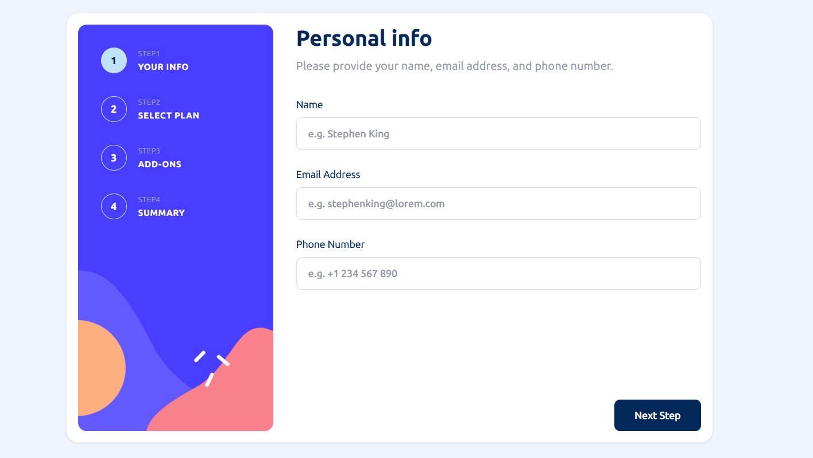
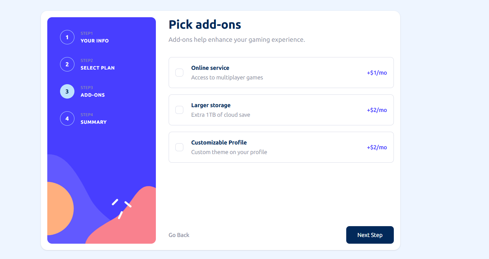
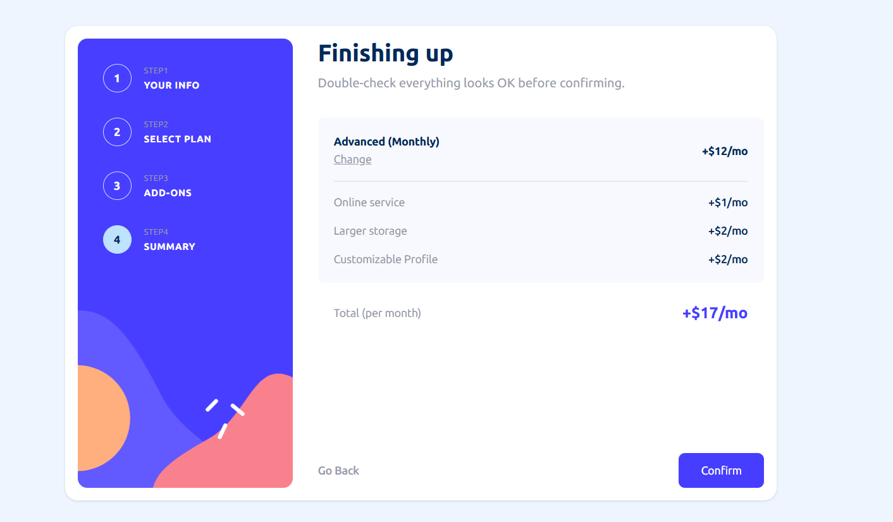
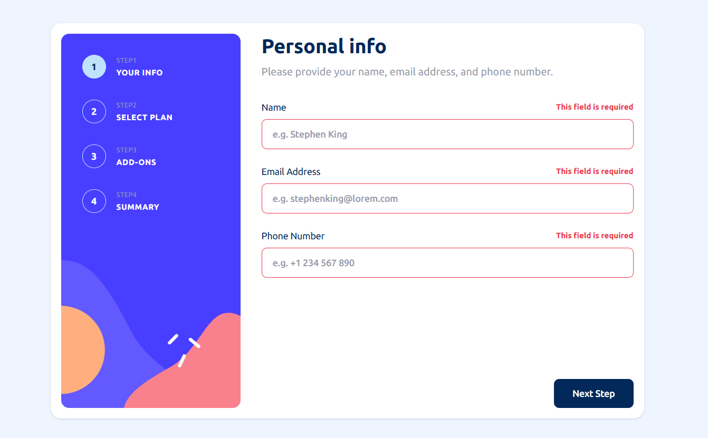

# ✅ Multi-Step Subscription Form – React + TypeScript + Tailwind CSS

A responsive and interactive **Multi-Step Subscription Form** built using **React, TypeScript, and Tailwind CSS**. Users can enter their personal information, choose a subscription plan, select additional services, and review their selections before confirming their subscription.

---

## 🌐 Live Demo

🔗 [Live Demo]()

---

## 📸 Screenshots

---

## ✨ Features

- Multi-step form with step-by-step navigation
- Personal information form with input validation
- Choose between **Arcade**, **Advanced**, and **Pro** subscription plans
- Toggle between **Monthly** and **Yearly** billing
- Select or deselect additional services (add-ons)
- Review selected plan and add-ons in the summary
- Automatically calculate the total subscription price
- Navigate between steps while retaining entered information
- Confirmation screen after successful submission
- Responsive and mobile-friendly layout

---

## 🚀 Technologies Used

- **React** – Functional components and hooks
- **TypeScript** – Static typing and type safety
- **Tailwind CSS** – Utility-first CSS framework
- **React Router** – Navigation between form steps
- **Context API** – Shared state across components
- **useReducer** – Centralized state management
- **Vite** – Development server and build tool

---